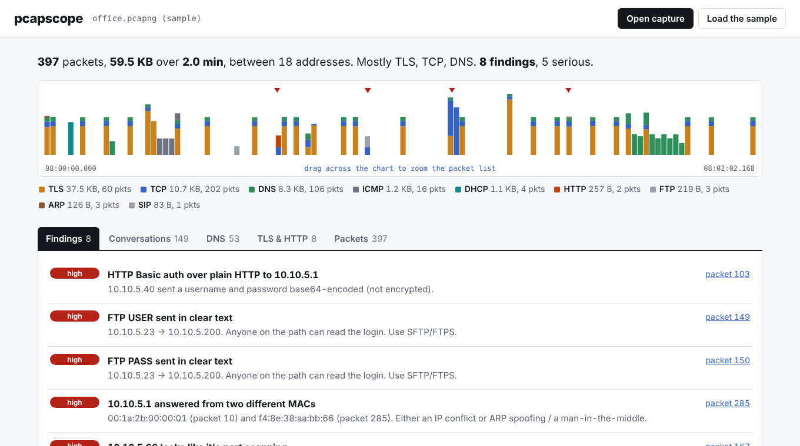
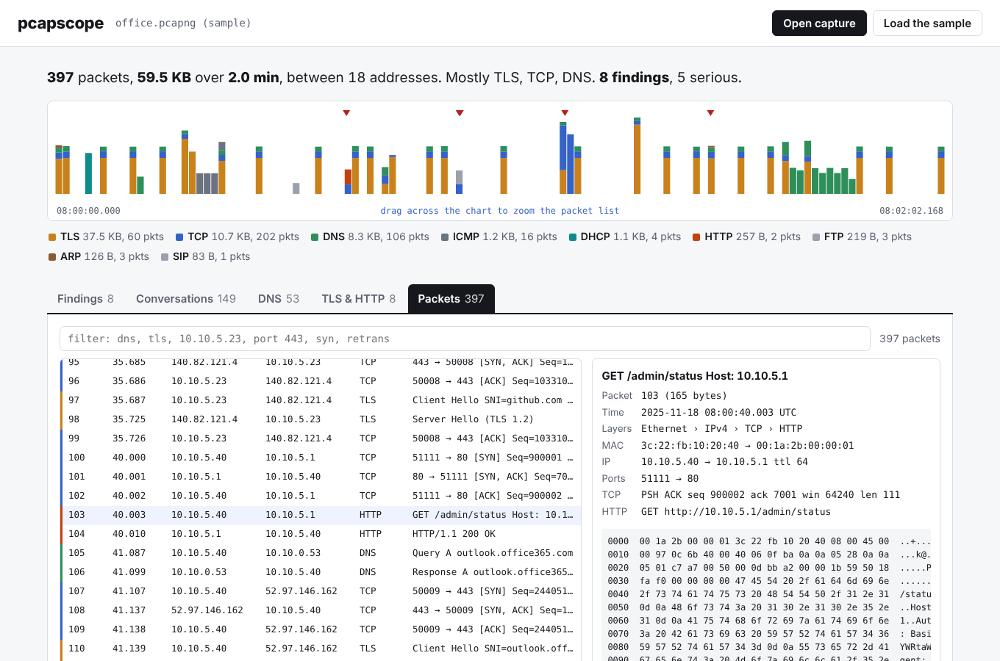

# pcapscope

Packet capture analysis in the browser. Drop a `.pcap` or `.pcapng` and get an overview a person can read: what protocols, who talked to whom, every DNS lookup, TLS server names, HTTP requests, and a list of findings worth a look. Nothing is uploaded. The file is parsed in a Web Worker on your machine.

**Live: https://greatslab.github.io/pcapscope/** (or open `?sample` to load the demo capture straight away)



## Why

Wireshark is the right tool when you know what you're looking for. A lot of the time you don't, yet. Someone hands you a capture from a customer's router, a SPAN port or a `tcpdump` on a server, and the first question is just "what's in here, and is anything obviously wrong?"

That first pass is always the same few Wireshark menus: Statistics → Protocol Hierarchy, Conversations, a `dns` filter, a `tls.handshake.extensions_server_name` column, then scrolling looking for red. pcapscope does that pass in one screen, and it works on a laptop that doesn't have Wireshark installed, which is most customer laptops.

## What it decodes

Written from scratch, no libraries:

- **File formats**: classic pcap (both byte orders, micro- and nanosecond timestamps) and **pcapng** (section/interface/enhanced/simple blocks, `if_tsresol`)
- **Link layers**: Ethernet, 802.1Q / QinQ VLAN tags, Linux cooked (SLL and SLL2), BSD loopback, raw IP
- **Network**: IPv4, IPv6 (with extension headers), ARP
- **Transport**: TCP (flags, seq/ack, retransmission detection), UDP, ICMP, ICMPv6
- **Application**: DNS (with name compression, A/AAAA/CNAME/MX/TXT/PTR answers), mDNS, LLMNR, **TLS ClientHello SNI + ALPN** and ServerHello version, HTTP requests/responses, DHCP (message type, hostname), SSH banners, SIP, QUIC Initial, cleartext FTP/Telnet/POP3/IMAP/SMTP lines

A port number only *suggests* a service. A packet gets labelled "MySQL" only if it carries data, so a port scan's empty SYNs don't show up as a wall of fake protocols.

## Findings

| | |
|---|---|
| **Credentials in clear text** | FTP `USER`/`PASS`, HTTP Basic auth over plain HTTP, Telnet sessions |
| **ARP spoofing** | the same IP answered from two different MAC addresses |
| **Port scans** | one source sending SYNs to 15+ ports on a host; host sweeps across 30+ hosts |
| **DGA-style lookups** | bursts of NXDOMAIN answers, per client |
| **DNS tunnelling** | queries with very long encoded-looking labels |
| **Old TLS** | servers negotiating SSL 3.0 / TLS 1.0 / 1.1 |
| **Network health** | TCP retransmissions (as % of packets), connections that never got a SYN-ACK, resets |

Each finding links straight to the packet. Click it and you land on that row with its layers and hex dump.



## The packet list

- filter words are ANDed: `dns`, `tls`, `10.10.5.23`, `10.10.` (prefix), `port 443`, `vlan 20`, `syn`, `rst`, `retrans`, or any text in the info column
- **drag across the timeline** to show only that time window
- virtual scrolling, so 200k packets scroll as smoothly as 200
- ↑/↓ to step through packets

## The sample

`samples/office.pcap` / `.pcapng` are **synthetic**, built byte by byte by [`tools/make_sample.py`](tools/make_sample.py) (no scapy). It's two minutes of a small office: browsing over TLS, DNS (v4 and v6), DHCP, pings, a VLAN-tagged SIP frame, and a few planted problems: a router admin page with Basic auth, an FTP login to a NAS, a port scan, ARP spoofing of the gateway, and a burst of random NXDOMAIN lookups. Because every packet was built by hand, the tests know exactly what each detector should find.

## Run locally

```
python3 -m http.server 8000      # module workers need http://, not file://
npm test                         # parser, decoder and detector tests (node 18+)
python3 tools/make_sample.py     # rebuild the sample captures
```

## Bugs I hit while building it

- **SIP looked like HTTP.** `OPTIONS sip:pbx SIP/2.0` matched the HTTP method check. SIP borrows HTTP's request syntax, so the version at the end of the line now decides.
- **The port scan polluted the protocol chart.** Labelling packets by port alone turned 60 empty SYNs into Telnet, MySQL, RDP, MongoDB... Now a port label only sticks if the packet carries data.
- **The "drop here" overlay never went away.** `display: grid` on the overlay beats the `hidden` attribute. One `[hidden] { display: none !important }` rule fixed it.

## Not done yet

- TCP stream reassembly (follow stream), so HTTP bodies and TLS split across segments decode
- JA3/JA4 TLS fingerprints
- Export findings as a markdown report

## License

MIT
